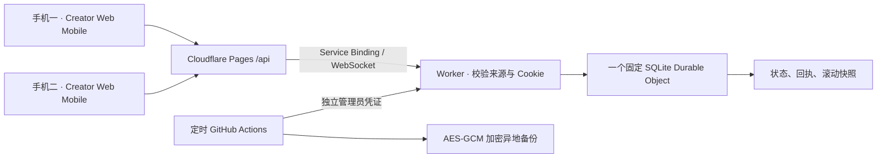

# 架构与第一阶段约束

游戏现名《余野和禾柚的小世界》，仍处于第一阶段功能原型。两个角色为占位形象，正式人物素材等待用户提供。内部服务名和存档身份保持原技术标识，避免 UI 改名改变数据寻址。

## 显示层与玩法边界

`PlanetGame` 保留输入、联网和移动请求；`WorldView` 接收快照／插值位置，仅维护角色、家具和背景显示；`CharacterView` 选择 SpriteFrame／idle、walk、hug 动画。六个可选 Prefab 字段在 Home 的 Bootstrap/PlanetGame 上配置，当前均为空，继续回退到原占位画面。

人物外观与场景资源 UUID 不进入服务器存档；角色贴图尺寸、Visual 子节点动画、Prefab 变化不能决定玩家身份、坐标、速度或拥抱距离。Phase 2 增加可选四方向 idle／walk 字段与通用动画回退，选择逻辑可独立测试，实际 Animation 播放尚未在编辑器验证；骨骼动画仍需单独的显示适配。后续接入正式二维美术无需改动协议和权威存档，见 `ASSETS.md`。

## 权威与身份

- 固定 `one`、`two` 两个身份。没有开放注册、房间列表或客户端指定的房间 ID。房间由服务端 `PLANET_ID` 决定；生产后保持其稳定，变更会指向另一份存档。
- 管理员离线生成每人一份 256 位随机私人配对凭证，服务端只配置 SHA-256 摘要；它们是可重复用于自己设备登录的长期高熵凭证，**不是一次性邀请码**。它们的保管方式类似密码。
- 配对后获得 30 天有效的 HMAC 签名 `__Host-planet` Cookie，`Secure; HttpOnly; SameSite=Strict; Path=/`。登录凭证不进入 URL、客户端本地存储或存档。
- Cookie 的签名还绑定该玩家当前的凭证摘要，轮换单人摘要会撤销该人的旧会话。WebSocket attachment 保存有效期、凭证摘要和会话密钥指纹，之后的事件／心跳也检查过期和撤销。轮换 `SESSION_SECRET` 会让两人的旧 Cookie 都失效，已有连接在后续事件／心跳时断开并要求重新配对。
- 浏览器登录、退出和 WebSocket 升级要求精确匹配 `ALLOWED_ORIGIN`，生产值为唯一正式 HTTPS 来源，不使用 `*`。不依赖跨站 Cookie，因此使用 Pages 同源代理。预览部署需要单独服务与存档，不能复用生产配置。
- 两个身份分别至多一个活动连接；同身份新连接关闭旧连接，防止多标签页互相抢占。身份由服务器从 Cookie 解析，客户端伪造的 `author`、`player`、`X-Player-Id` 均不能改变身份。
- 登录按平台提供的来源 IP 摘要限速，每分钟最多 10 次；WebSocket 每连接每秒最多 30 个事件。限速不是对已泄露凭证的替代防护。

限制：只有两份身份，不等于能够辨认现实中的第三个人。拿到某位玩家配对凭证的人可以冒充该玩家，应立即轮换凭证。当前没有 Passkey、多因素认证或用户管理后台；不要把私人凭证做成公开分享链接。

## 同步和持久化

- 协议 `v:1`，每个命令有客户端随机 UUID。连接／重连发 `state` 全量快照和在线名单；移动发 `moved` 坐标增量；拥抱发瞬时 `hug`；心跳返回 `pong`。
- 每位玩家独立坐标；服务端只允许移动发起者本人，校验房间边界，并按时间和 150 单位／秒限制位移。客户端约每 100ms 请求一次移动，不在断线期间积压移动或拥抱。
- 拥抱要求双方在线且距离不超过 65，单人每两秒最多一次。拥抱是瞬时动画，离线不重放，不写入永久存档。
- 家具支持三种、最多 24 件，检查边界和相互 28 单位间距。两人都有摆放／整理／收起权限；不是复杂碰撞物理系统，角色可以穿过家具。
- 留言按服务器时间记录作者，最多 240 个 UTF-16 码元，保留最近 100 条。客户端留言簿可以逐条阅读；旧留言会随条数上限移出活动存档，历史只能从备份读取。
- 共享 `revision` 每次持久变更递增。SQLite 同步事务一次提交状态和回执；没有两个玩家同时保存整份客户端状态的接口，因此不会后写覆盖整份存档。
- 家具和留言的命令回执永久记录以保证相同操作编号重试不会重复执行。客户端先将这些操作写入浏览器本地待发送队列，再依次发送；收到权威确认后才出队。服务端明确拒绝的操作提示失败并出队，临时限速稍后重试。
- “对方离线但自己在线”可正常操作并立即保存。自己也失去网络时，留言／家具只是在本机排队；关闭页面仍可保留，清理浏览器数据则会丢失尚未同步的队列。不能将排队提示解释为云端已保存。
- 断线指数退避重连；心跳检查静默断网，30 秒无消息时重建连接；重连取得最新快照后补发队列。会话过期要求刷新并重新配对。

## 备份边界

SQLite 定时 alarm 每 24 小时生成一份快照，最多保留最近 14 份，恢复前也自动留快照。管理员可以列出、获取和手动生成快照。这些与主存档在同一个 Durable Object 内，不能替代异地备份。

异地备份包含世界与去重回执，使用独立管理员 Bearer 凭证读取，AES-256-GCM 加密后保存；加密密钥独立保管。恢复只允许双方离线，完整校验文件并在一个事务中恢复，先备份当前状态，再令 revision 前进。

MVP 管理恢复接口限制 4MB、50,000 条回执。长期运行应监测备份体积与回执数量；接近上限前需要增加分片／流式导入方案，不能删除回执来绕过去重。自动快照的定时触发尚需在 Cloudflare 部署后观察，测试覆盖手动快照和同一导出／恢复逻辑。

## 免费层与隐私

自绘 Graphics 占位资源没有第三方资源许可问题。Cloudflare 免费层的额度和可用功能以部署时控制台为准；双人低频使用并不保证永远零费用，应配置额度提醒。不要记录 WebSocket 内容、Cookie、配对明文或留言到公共日志。这个项目不能阻止授权玩家截图或主动分享内容。
